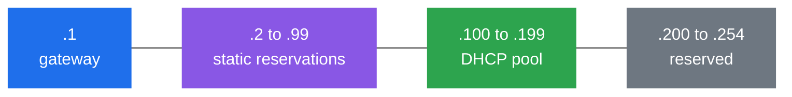
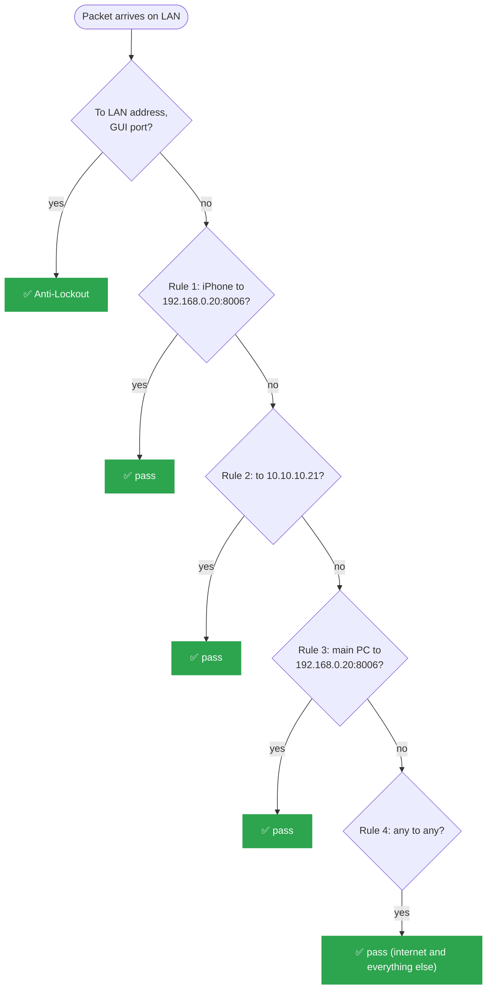

# pfSense Configuration

# Current State (as of 2026-09-25)

## IP Allocation Scheme (Legacy LAN, 10.10.10.0/24)
| Range | Purpose |
|---|---|
| `.1` | pfSense LAN gateway |
| `.2–.99` | Static IP reservations |
| `.100–.199` | DHCP dynamic pool |
| `.200–.254` | Reserved for future use |

> [!NOTE]
> Legacy LAN still exists and carries the AP/WiFi and any untagged 
> devices. Being phased out as VLANs take over.

## VLANs
| VLAN | Name | Subnet | Gateway | Purpose |
|---|---|---|---|---|
| 10 | Management | `10.10.11.0/24` | `10.10.11.1` | Admin PC, future PiKVM |
| 20 | Servers | `10.10.20.0/24` | `10.10.20.1` | DC01, WIN11-01 |
| 30 | Clients | `10.10.30.0/24` | `10.10.30.1` | Mobile/WiFi devices |
| 40 | Security | `10.10.40.0/24` | `10.10.40.1` | Future Vaio, Kali |

DHCP range on every VLAN: `.100–.199`.

> [!NOTE] VLAN status
> All four VLANs are currently empty. DC01 and WIN11-01 were on Servers (20) 
> from 2026-09-11 until the move to `proxmox-lab` on 2026-09-23, and sit on the 
> Legacy LAN until that node gets a VLAN 20 trunk: see [[Proxmox Lab Setup]].

### Active Firewall Rules: LAN (legacy)

pfSense checks rules **top to bottom, first match wins**. Anything that matches no rule is dropped.

| # | Protocol | Source | Destination | Port | Action | Description |
|---|---|---|---|---|---|---|
| n/a | * | * | LAN Address | 443, 80 | Pass | Anti-Lockout Rule (default). Follows the WebGUI port: 443 for HTTPS, 80 for the redirect |
| 1 | TCP | 10.10.10.108 (iPhone, static mapping) | 192.168.0.20 | 8006 | Pass | Clyde's iPhone → Proxmox WebUI |
| 2 | TCP | * | 10.10.10.21 | any | Pass | DC01. Load-bearing for when DC01 moves to VLAN 20 (see [[Proxmox Lab Setup]]); 0 B today because same-subnet traffic never crosses pfSense |
| 3 | TCP | 10.10.10.23 (main PC) | 192.168.0.20 | 8006 | Pass | Allow main PC → Proxmox WebUI |
| 4 | IPv4 any | * | * | any | Pass | "Allow LAN to Internet". Live destination is `*` (any), not `!LAN net`: it makes rules 1 to 3 redundant. To be narrowed after VLAN migration |
| n/a | IPv4 | LAN subnets | any | any | Disabled | Default allow LAN to any (kept as fallback) |
| n/a | IPv6 | LAN subnets | any | any | Disabled | Unused |

### Active Firewall Rules: per VLAN
| Interface | Source | Destination | Protocol | Action | Description |
|---|---|---|---|---|---|
| SERVERS | SERVERS subnet | any | any | Pass | Allow Servers → Internet |
| MANAGEMENT | MANAGEMENT subnet | any | any | Pass | Allow Management → Internet |
| CLIENTS | CLIENTS subnet | any | any | Pass | Allow Clients → Internet |
| SECURITY | SECURITY subnet | any | any | Pass | Allow Security → Internet |

> [!NOTE]
> No inter-VLAN rules exist yet: default-deny between segments until 
> deliberate rules are added.

## WebGUI
| Item | Value |
|---|---|
| URL | `https://10.10.10.1` |
| Protocol | HTTPS, default self-signed certificate |
| HTTP (80) | 301 redirect to HTTPS |

## NAT
Mode: **Automatic outbound NAT**, using dynamic "WAN address" reference.

### Known Pending Items

> [!WARNING] Known Pending Items
> - **DC01 rule (#2)** points to `10.10.10.21`: correct while DC01 is on the Legacy LAN, revisit once VLAN 20 is trunked. Protocol is TCP only, so UDP (DNS, Kerberos, NTP) would fall through to rule 4
> - **Rule 4 is allow-any**: rules 1 to 3 are redundant until it is narrowed. Narrow it after the VLAN migration, not before: family devices share this LAN and would lose access
> - **NTP** fails to sync on every boot (see 2026-09-16)
> - **WAN rules** "Allow all ipv4+ipv6 via pfSsh.php" (from `enableallowallwan`): both disabled 2026-10-03, delete once nothing breaks (see 2026-10-03)
> - **Proxmox WebUI** sits outside pfSense entirely (`192.168.0.20:8006`, 
>   on the ISP router's network)
> - **AP/WiFi still on legacy flat LAN, untagged**: blocked on a managed 
>   switch/AP with 802.1Q support
> - **Main PC not yet migrated to Management VLAN**

---

# Change Log

### 2026-09-08/09: Initial LAN lockdown
- Found default "allow any" rule active on LAN, no restrictions

- Added explicit rules: LAN→DC01, PC→Proxmox, LAN→Internet
- Disabled (not deleted) the default allow-any rule
- **Issue**: mobile lost internet: rule 3 was TCP-only, blocking DNS 
  (UDP). Fixed by setting protocol to `any`.

### 2026-09-10: DHCP range conflict
- Attempted static mapping at `.50`, rejected: DHCP pool covered the 
  entire subnet

- Fixed: reduced DHCP pool to `.100–.199`

### 2026-09-10: NAT reviewed
- Confirmed Automatic Outbound NAT, dynamic "WAN address": correct for 
  a dynamic ISP-assigned public IP

### 2026-09-11: VLAN segmentation implemented
- Enabled "VLAN aware" on Proxmox LAN bridge

- Tagged DC01/WIN11-01 with VLAN 20

- Created 4 VLAN interfaces in pfSense, static IP per VLAN

- Enabled DHCP per VLAN

- Added baseline internet-access rule per VLAN
- **Issue (repeat)**: rules set to TCP only initially: same mistake as 
  the LAN lockdown. Fixed to `any`.

- Migrated DC01's DHCP static mapping: LAN → SERVERS, 
  `10.10.10.21` → `10.10.20.21`

### 2026-09-11: Known blocker: physical VLAN segmentation incomplete
- AP connects to the legacy flat LAN, untagged: MGMT/CLIENTS/SECURITY 
  VLANs are configured but empty
- Blocked on: managed switch or AP with 802.1Q support

### **2026-09-16: LAN gateway auto-selected as default, breaking WAN routing**

- **Symptom:** LAN clients got valid DHCP leases and could reach the pfSense GUI, but had no internet access. WAN gateway (WAN_DHCP) showed "pending" in Status > Gateways.
- **Root cause:** No IPv4 default gateway was explicitly pinned in System > Routing > Gateways. pfSense's automatic gateway-selection logic defaulted to LAN's gateway (LANGW) instead of WAN on every boot/reload, confirmed recurring across multiple reboots in system logs predating this session.
- **Contributing/secondary issue:** During interface reassignment via console (20:13), dhcpd briefly failed to bind to LAN ("no subnet declaration for vtnet1"): transient, self-resolved by the next filter reload once the interface's IP was consistently applied.
- **Fix:** System > Routing > Gateways > edit WAN_DHCP > check "Default Gateway" (IPv4) > save.
- **Verification:** Status > Gateways shows WAN_DHCP online (default); phone regained internet access.
- **Follow-up:** NTP fails to sync (config syntax error in ntpd startup, every boot): clock reliability affects log timestamp accuracy; needs separate fix.

### **2026-09-16: Aftermath of the issue**
- **DHCP Static Mapping**: Static mapping had an issue since it detected that the main laptop´s IP is already taken by a different device, so we had to change it from 10.10.10.8 to 10.10.10.23.
- **Firewall Proxmox Rule:** Since we have changed the IP address of the main laptop we had to modify the firewall rule source.

### 2026-09-24: WebGUI switched from HTTP to HTTPS
- **Found while:** building the Homepage dashboard. Its `siteMonitor` check on `https://10.10.10.1` stayed red.
- **Diagnosis (from `10.10.10.124`, same LAN):** `https://10.10.10.1` timed out, `http://10.10.10.1` returned 200. The WebGUI was served over plain HTTP. The anti-lockout rule only passes the GUI's own port (80), so 443 hit the default deny and was dropped silently (timeout, not "refused").
- **Why it matters:** over HTTP the admin password crossed the LAN in clear text, readable by anyone capturing traffic.
- **Fix:** `System > Advanced > Admin Access` > Protocol: HTTPS (SSL/TLS), default self-signed certificate.
- **Verification:** `https://10.10.10.1` returns HTTP/2 200, `http://10.10.10.1` returns 301 to HTTPS, dashboard `siteMonitor` green. No firewall rule was added: the anti-lockout rule followed the port change on its own.

### 2026-09-25: Doc audit against live state
- Rule table: rule 2 source updated to `10.10.10.23` (the live change was already logged on 2026-09-16, the table wasn't). Rule 1 relabelled load-bearing.
- VLAN status note updated: no VLAN has devices since the 2026-09-23 migration.
- Three screenshots flagged as missing were in `attachments/` all along. Rule 2/3 test screenshots embedded, alias warning dropped.
- **Verification:** TCP checks from `claude-srv`: `10.10.10.1:443` open, `192.168.0.20:8006` open (this last one led to the rule 2 question above).

### 2026-10-03: LAN ruleset review, WAN allow-all disabled
- **Rule table brought in line with the live box.** Rule "Allow LAN to Internet" is `* -> *` (allow any), not `LAN net -> !LAN net` as documented. Rules 1 to 3 never decide anything while it exists.
- **Rule 2 question closed.** The main PC rule has source `10.10.10.23` (536 MiB) and works. Redundant because of rule 4, kept as documentation of intent.
- **iPhone:** static DHCP mapping added for `10.10.10.108`, rule narrowed from any port to TCP 8006.
- **Dead rule removed:** `10.10.10.1 -> 10.10.10.2` (pfSense to proxmox-lab). Traffic pfSense originates does not pass through its own LAN rules, so it could never match (0 B).
- **WAN allow-all disabled** (both "via pfSsh.php" rules). State filter on their rule IDs showed only router noise (DHCPv6 from `fe80::1`, IGMP query to `224.0.0.1`). WAN GUI from the phone no longer reachable, accepted. Delete once nothing breaks.
- **LAN traffic review (states on the allow-any rule):** almost all outbound TCP 443, plus QUIC (UDP 443) and Tailscale (UDP 3478, 41641). Family devices share this LAN with the lab servers. No per-port rules written for them: the fix is moving them to Clients (30) once the managed switch and AP carry VLAN tags.
- **Backup:** `config.xml` downloaded before any rule change.
